# 🎓 LEARNHUB
### Learn Today. Grow Everywhere.


## 📖 Overview

LearnHub is a Flutter-based e-learning mobile application designed to provide users with an interactive and convenient online learning experience.

Users can explore courses, search by course name, browse categories, watch video lessons, track their learning progress, and manage their profiles.

The application uses Firebase Authentication for secure user authentication and Cloud Firestore for storing course information, lessons, enrollments, and learning progress.


## 📱 App Preview

### 🏠 Home Screen

<p align="center">
  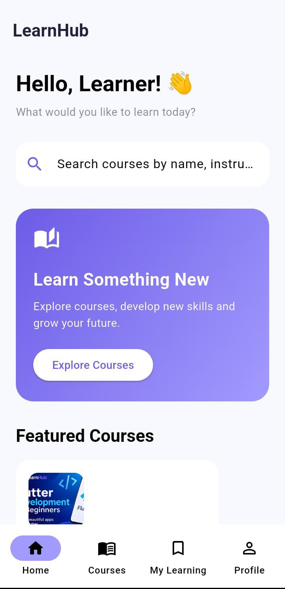
  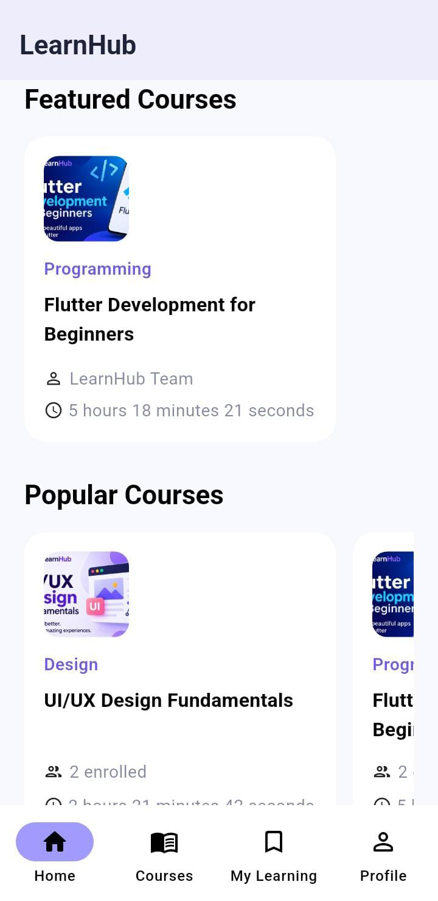
  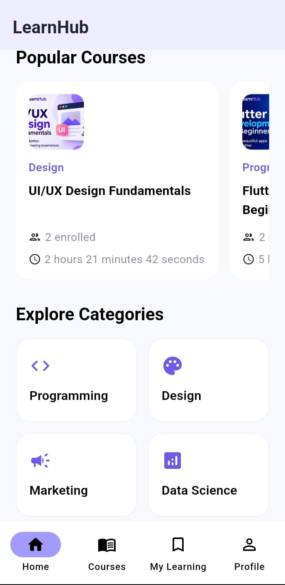
</p>

### 🔎 Course Exploration

<p align="center">
  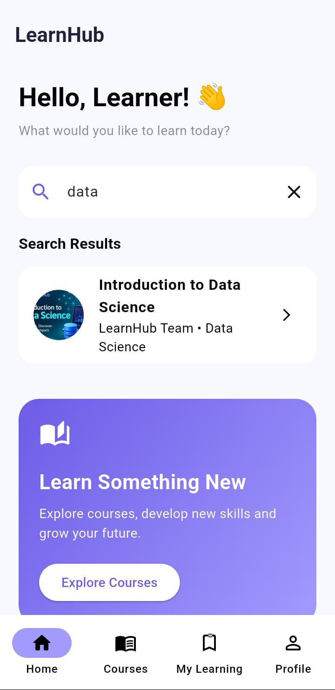
  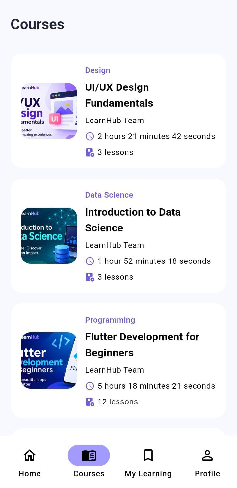
</p>

### 📚 Course Learning

<p align="center">
  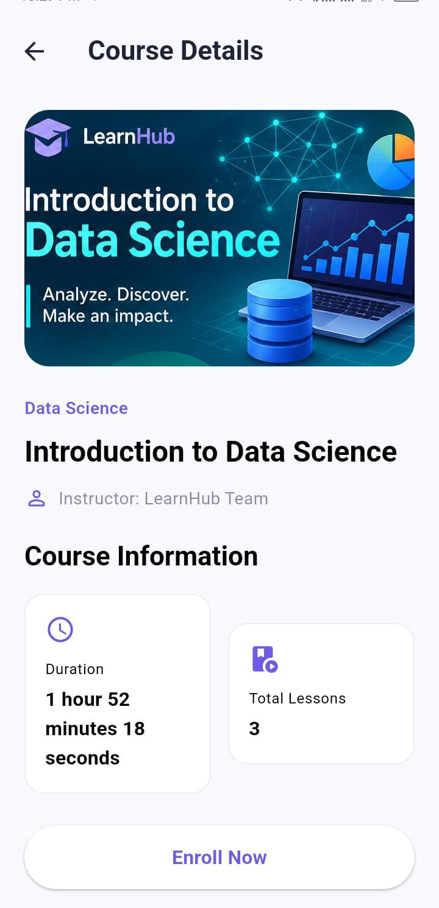
  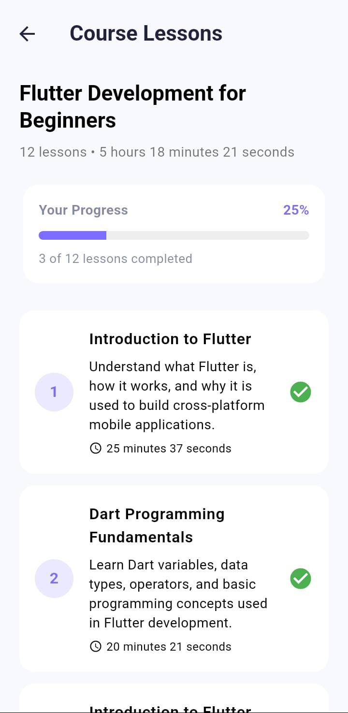
  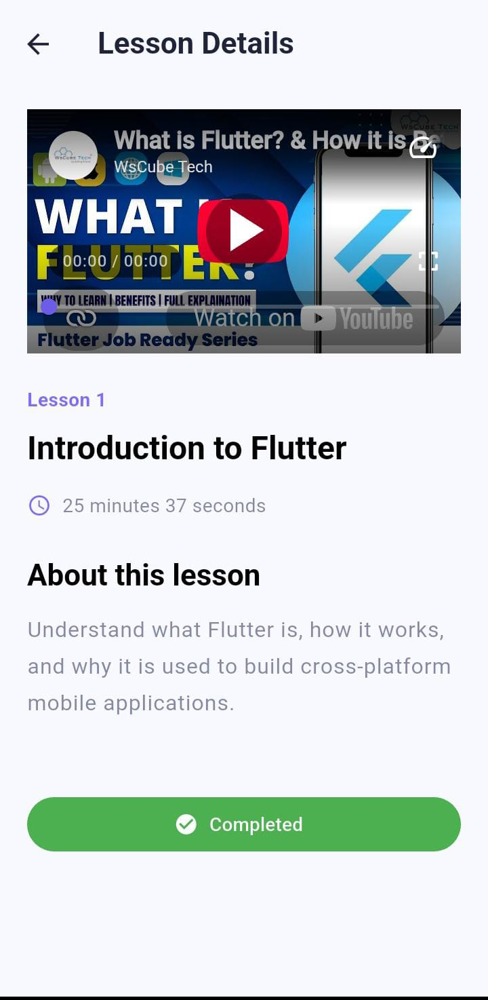
</p>

### 📊 My Learning

<p align="center">
  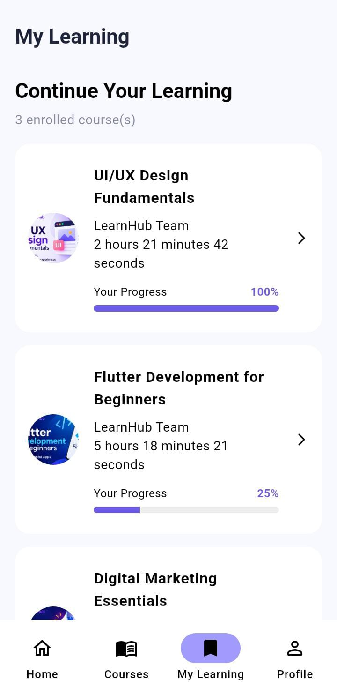
</p>

### 👤 Profile & Appearance

<p align="center">
  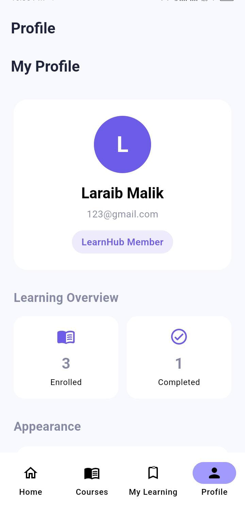
  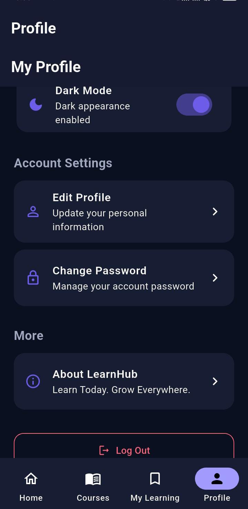
  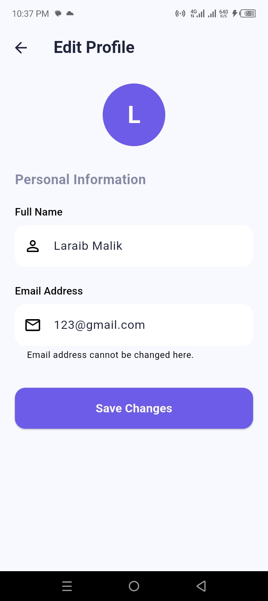
</p>


## ✨ Key Features

### 🔐 Authentication
- User registration with email and password.
- Secure login using Firebase Authentication.
- Logout functionality.

### 🏠 Home Screen
- Featured courses.
- Popular courses.
- Course categories.
- Easy navigation.

### 🔎 Course Exploration
- Search courses by name.
- Browse courses by category.
- Explore Programming, Design, Marketing, and Data Science courses.

### 📚 Course Details
- Course thumbnail and title.
- Instructor information.
- Course description.
- Course duration.
- Course enrollment.

### 🎥 Video Lessons
- View course lessons.
- Play video lessons.
- Mark lessons as completed.
- Track lesson completion.

### 📊 Learning Progress
- Enroll in courses.
- View enrolled courses in My Learning.
- Track completed lessons.
- Monitor course progress.
- Automatically update course completion status.

### 👤 User Profile
- View and edit profile information.
- Change password.
- Switch between light and dark themes.
- Save theme preferences.
- About section.
- Logout.

## 🔄 Application Flow

```text
        Splash Screen
              |
        Onboarding
              |
         Authentication
              |
          Home Screen
              |
     ---------------------
     |         |         |
  Courses   Search    Profile
     |
 Course Details
     |
   Enroll
     |
   Lessons
     |
 Video Playback
     |
 Mark Completed
     |
 Learning Progress
     |
  My Learning
```

## 🛠️ Technology Stack

| Technology | Purpose |
|---|---|
| Flutter | Cross-platform application development |
| Dart | Programming language |
| Material Design | User interface |
| Provider | State management |
| Firebase Authentication | User authentication |
| Cloud Firestore | Cloud database |
| VS Code | Development environment |
| Android SDK | Android development |

## 📁 Project Structure

```text
flutter_learnhub_app/
│
├── android/
├── assets/
│   └── images/
│
├── lib/
│   ├── models/
│   ├── providers/
│   ├── screens/
│   ├── services/
│   ├── theme/
│   ├── utils/
│   ├── widgets/
│   └── main.dart
│
├── screenshots/
├── test/
├── pubspec.yaml
├── pubspec.lock
└── README.md
```

## 🔥 Firebase Integration

LearnHub uses Firebase services:

- **Firebase Authentication:** Handles user registration, login, and authentication.
- **Cloud Firestore:** Stores course information, lessons, enrollments, and learning progress.

## 🚀 Getting Started

### Prerequisites

- Flutter SDK
- Dart SDK
- Android Studio or VS Code
- Firebase project
- Android emulator or physical Android device

### Installation

1. Clone the repository:

```bash
git clone YOUR_GITHUB_REPOSITORY_URL
```

2. Navigate to the project directory:

```bash
cd flutter_learnhub_app
```

3. Install dependencies:

```bash
flutter pub get
```

4. Configure Firebase for your project.

5. Run the application:

```bash
flutter run
```

## 🧪 Testing

Run Flutter static analysis:

```bash
flutter analyze
```

Run project tests:

```bash
flutter test
```

## 🎯 Project Objectives

- Provide an accessible online learning platform.
- Make course discovery simple and convenient.
- Allow users to learn through video lessons.
- Track lesson and course completion.
- Provide a clean and responsive user interface.
- Store user and course data using Firebase.

## 📌 Project Status

**Completed** — Internship Project

## 👩‍💻 Developer

**Laraib Malik**

🎓 IT Student | Flutter Developer

- 🐙 **GitHub:** [@LaraibMalik71](https://github.com/LaraibMalik71)
- 📧 **Email:** hh2999720@gmail.com


